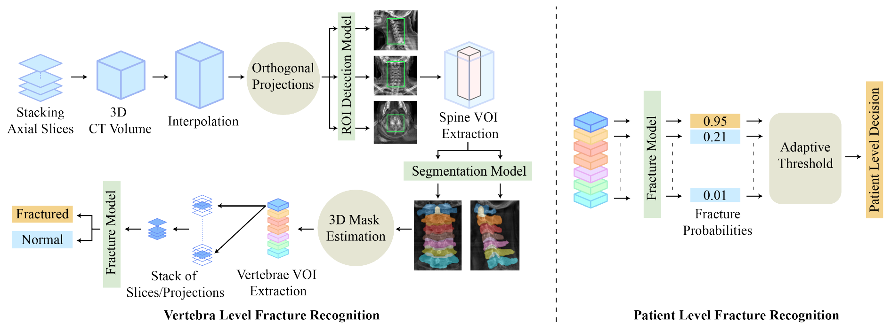
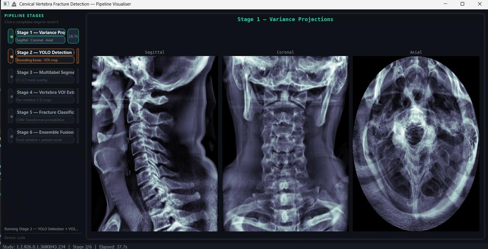
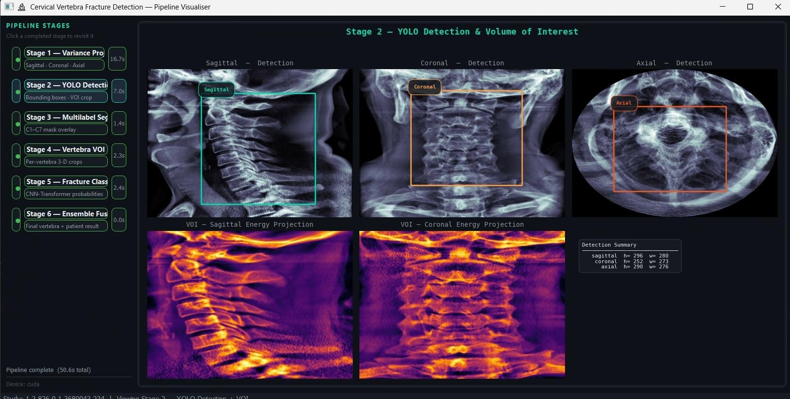
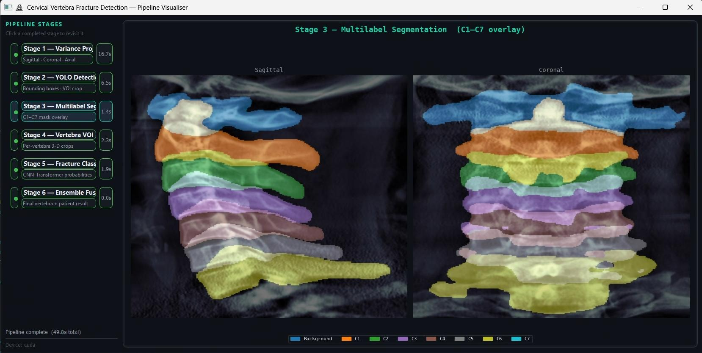
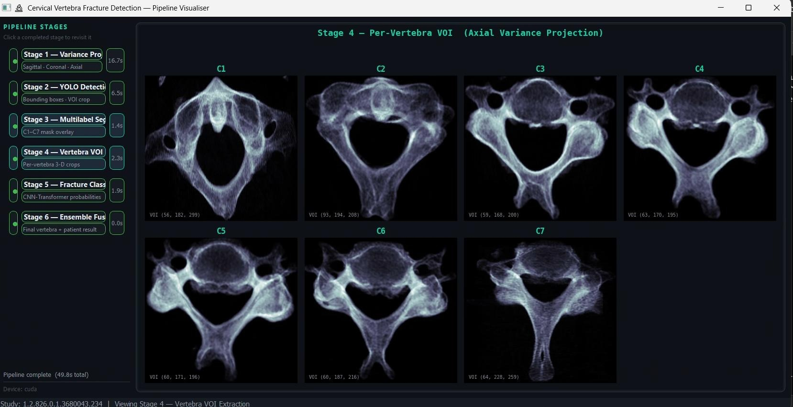
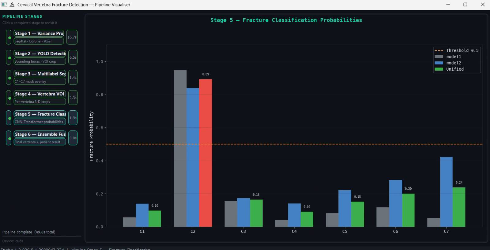
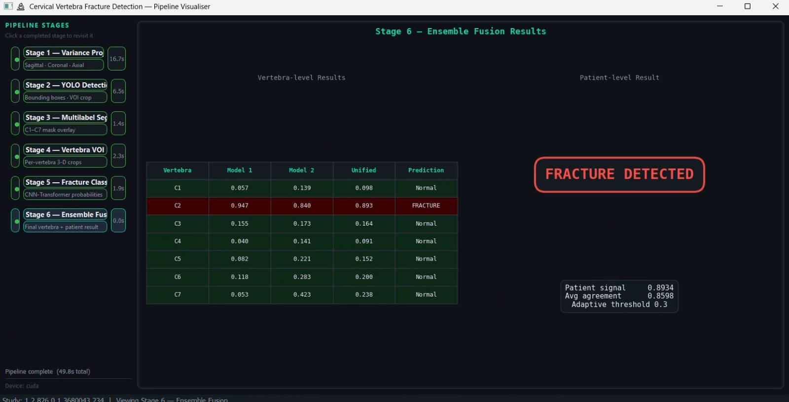

<div align="center">

# Tracing 3D Anatomy in 2D Strokes

### Can Projection-Derived Masks Replace 3D Segmentation for Cervical Spine Fracture Recognition?

[](https://arxiv.org/abs/2601.15235)
[](https://opensource.org/licenses/MIT)
[](https://www.python.org/downloads/)
[](https://pytorch.org/)

[Paper](https://arxiv.org/abs/2601.15235) • [Weights & Data](https://drive.google.com/drive/folders/1IXJYOVUrWsZqV3n2BKXotOfgk6Vsl3x9?usp=sharing) • [Dataset](https://www.kaggle.com/competitions/rsna-2022-cervical-spine-fracture-detection)

</div>

---

## 🔬 Overview

This repository provides the official implementation for detecting cervical vertebra (C1–C7) fractures from CT volumes using a **projection-driven pipeline**. Instead of relying on full 3D segmentation networks, we approximate 3D vertebra volumes from optimized 2D projections (axial, sagittal and coronal for localization; sagittal and coronal for vertebra segmentation), and test whether these approximate masks retain enough anatomical context for fracture recognition.

<div align="center">

</div>

### Key Contributions

- **Matched Comparison with 3D Segmentation**: Projection-derived and 3D-segmentation masks evaluated under the same classifier, folds and paired statistics (fold-wise t-test and patient-clustered bootstrap)
- **Projection-Driven VOI Extraction**: Traces 3D cervical anatomy using variance and energy-based 2D projections, reconstructing approximate 3D vertebra masks from 2D localization and multi-label segmentation
- **2.5D Spatio-Sequential CNN-Transformer**: An ensemble of two 2.5D models that captures spatial and sequential context across vertebra volumes for fracture classification
- **Lower-Dimensional Segmentation**: Vertebra segmentation runs on two 2D projections (33.6 GFLOPs against 836.8 for the 3D U-Net of the RSNA 2022 winning solution); the saving applies to the segmentation stage only
- **Clinical Validation**: Inter-observer study with three expert radiologists using Cohen's κ and Fleiss' κ to benchmark model performance against human readers
- **Clinical Realism**: Validated on the highly imbalanced RSNA 2022 dataset without artificial balancing

---

## 📊 Performance

Evaluated on the [RSNA 2022 Cervical Spine Fracture Detection](https://www.kaggle.com/competitions/rsna-2022-cervical-spine-fracture-detection) dataset using **5-fold patient-wise cross-validation** (all 2,019 patients / 14,133 vertebrae; mean ± SD over the five test folds; a vertebra without a VOI is scored as non-fractured):

| Level | Accuracy | Precision | Sensitivity | Specificity | F1 | ROC-AUC | AUPRC |
|-------|----------|-----------|-------------|-------------|----|---------|-------|
| **Vertebra** | 94.51 ± 0.69 | 84.16 ± 4.82 | 57.49 ± 4.30 | 98.74 ± 0.47 | 68.15 ± 2.80 | 91.63 ± 0.99 | 75.64 ± 1.37 |
| **Patient** (adaptive threshold) | 83.06 ± 3.13 | 82.12 ± 4.64 | 82.51 ± 1.74 | 83.56 ± 4.75 | 82.28 ± 3.05 | 90.95 ± 1.47 | 92.00 ± 1.15 |

**Projection-derived vs 3D-segmentation masks.** With the classifier, training protocol and folds fixed, replacing 3D-segmentation masks with projection-derived masks changed AUPRC by +1.03 points per vertebra and +0.65 per patient; the fold-wise 95% CI excluded vertebra-level losses larger than 1.46 points. Against the reproduced RSNA 2022 winning solution (single model), AUPRC was 75.64% vs 76.19% per vertebra and 92.00% vs 91.86% per patient (loss bound 2.81 points). No AUPRC difference was statistically significant.

The fold assignment is provided in [`folds/`](folds) and the statistical code in [`stats/`](stats) (see [Reproducing the evaluation](#-reproducing-the-evaluation)).

---

## 👨‍⚕️ Clinical Validation

A key component of this work is the **inter-observer agreement study** comparing model predictions against expert radiologist assessments.

### Expert Panel

| Radiologist | Role & Affiliation |
|-------------|-------------------|
| [Dr. Adam Mushtak](https://scholar.google.com/citations?user=1s3pZBQAAAAJ&hl=en) | Diagnostic Radiologist at Hamad Medical Corporation |
| [Dr. Israa Al-Hashimi](https://scholar.google.com/citations?user=f1XBd0QAAAAJ&hl=en) | Radiology Resident at Hamad Medical Corporation |
| [Dr. Sohaib Bassam Zoghoul](https://scholar.google.com/citations?user=3ZvCHjoAAAAJ&hl=en) | Diagnostic and Interventional Radiologist at Hamad Medical Corporation |

### Agreement Metrics

- **Cohen's Kappa (κ)**: Agreement of the model and of each radiologist with the dataset reference standard, and pairwise agreement between radiologists
- **Fleiss' Kappa (κ)**: Multi-rater agreement among the three radiologists and the reference standard

This inter-observer analysis contextualizes model performance within the inherent variability of expert human readers, providing clinically meaningful benchmarks beyond standard machine learning metrics.

---

## 🏗️ Pipeline Architecture

```
CT Volume (DICOM)
       │
       ▼
┌──────────────────────────────────────────────────────────────┐
│  Stage 1  │  Variance Projections (Sagittal/Coronal/Axial)   │
│  Stage 2  │  YOLO Detection → Volume of Interest (VOI) Crop  │
│  Stage 3  │  Multi-label U-Net Segmentation (C1–C7 Masks)    │
│  Stage 4  │  Per-Vertebra 3D VOI Extraction                  │
│  Stage 5  │  CNN-Transformer Fracture Classification         │
│  Stage 6  │  Ensemble Fusion → Patient-Level Prediction      │
└──────────────────────────────────────────────────────────────┘
       │
       ▼
Vertebra-Level Probabilities + Patient-Level Prediction
```

| Stage | Description | Output |
|-------|-------------|--------|
| **1** | Variance projections in three orthogonal planes, with cascaded slice selection: sagittal over a fixed range, coronal over the sagittal detection's extent, axial over the mean vertical extent of the sagittal and coronal detections | 2D projection images |
| **2** | Detect the cervical spine on each projection with YOLOv8 and fuse the three boxes into a 3D crop; compute energy projections of the crop | Cropped VOI volume |
| **3** | Multi-label segmentation of C1–C7 on the sagittal and coronal energy projections (U-Net, DenseNet encoder) | Per-vertebra 2D masks |
| **4** | Extrude and intersect the two 2D masks to obtain each vertebra's 3D VOI | Individual vertebra VOIs |
| **5** | Classify each vertebra with two 2.5D CNN-Transformers: axial slice stacks, and stacks of maximum-intensity projections | Fracture probabilities |
| **6** | Average the two models per vertebra (threshold 0.5); patient level uses an agreement-adaptive threshold on the maximum vertebra score | Final diagnosis |

---

## 🖥️ Visualization Dashboard

An interactive Qt-based dashboard visualizes every stage of the pipeline in real-time. Click any completed stage in the sidebar to inspect its outputs.

```bash
python visualize.py --dicom-dir "ct_volumes/your_study_id"
```

<div align="center">

<table>
<tr>
<td align="center" width="50%">
<br/>
<b>Stage 1: Variance Projections</b><br/>
<em>Generates variance-based 2D projections across sagittal, coronal, and axial planes</em>
</td>
<td align="center" width="50%">
<br/>
<b>Stage 2: VOI Detection</b><br/>
<em>YOLOv8 localizes the cervical spine region and crops the VOI</em>
</td>
</tr>
<tr>
<td align="center">
<br/>
<b>Stage 3: Multi-label Segmentation</b><br/>
<em>U-Net segments individual vertebrae (C1–C7) in 2D projections</em>
</td>
<td align="center">
<br/>
<b>Stage 4: Per-Vertebra VOI Extraction</b><br/>
<em>Reconstructs 3D vertebra volumes from 2D segmentation masks</em>
</td>
</tr>
<tr>
<td align="center">
<br/>
<b>Stage 5: Fracture Classification</b><br/>
<em>2.5D CNN-Transformer classifies each vertebra for fracture presence</em>
</td>
<td align="center">
<br/>
<b>Stage 6: Ensemble Fusion</b><br/>
<em>Adaptive fusion produces vertebra-level and patient-level predictions</em>
</td>
</tr>
</table>

</div>

---

## 📁 Repository Structure

```
├── config.py                 # Paths and hyperparameters (configure here)
├── model.py                  # CNN-Transformer architecture definition
├── utils.py                  # DICOM I/O and preprocessing utilities
├── run.py                    # CLI inference entry point
├── visualize.py              # Interactive Qt-based visualization dashboard
├── requirements.txt          # Python dependencies
│
├── folds/                    # 5-fold cross-validation splits (classification and segmentation)
│   ├── classification_folds.csv
│   └── segmentation_folds.csv
│
├── stats/                    # 95% CIs and significance tests used in the paper
│   └── ci95.py
│
├── seg3d_pipeline/           # Comparison pipeline: 3D U-Net segmentation instead of projections
│   ├── config_3d.py
│   ├── model_3d.py
│   └── stages_3d.py
├── compare_pipelines.py      # Run both pipelines on one study, side by side
│
├── scripts/                  # Modular stage implementations
│   ├── stage1_projections.py
│   ├── stage2_voi.py
│   ├── stage3_segmentation.py
│   ├── stage4_vertebra_vois.py
│   ├── stage5_classification.py
│   └── stage6_ensemble.py
│
├── weights/                  # Pretrained model weights (download separately)
├── weights_3d/               # Weights of the 3D-segmentation comparison pipeline (download separately)
├── ct_volumes/               # Input DICOM studies (one folder per study)
├── results/                  # Final predictions (created at runtime)
├── intermediates/            # Stage outputs (with --save-intermediates)
└── assets/                   # Documentation figures
```

---

## ⚙️ Installation

### Requirements

- Python 3.11+
- CUDA 11.8+ (for GPU acceleration)
- ~8GB GPU memory recommended

### Setup

```bash
# Clone the repository
git clone https://github.com/fabinahian/cervical_spine_fracture_identification.git
cd cervical_spine_fracture_identification

# Create virtual environment (recommended)
python -m venv venv
source venv/bin/activate  # Linux/macOS
# or: venv\Scripts\activate  # Windows

# Install dependencies
pip install -r requirements.txt
```

### Download Pretrained Weights

Download the pretrained weights and sample DICOM data from Google Drive:

**[⬇️ Download Weights & Sample Data](https://drive.google.com/drive/folders/1IXJYOVUrWsZqV3n2BKXotOfgk6Vsl3x9?usp=sharing)**

Place the contents into the `weights/` and `ct_volumes/` directories respectively.

The two classifier checkpoints (`slice_stack_classification.pth`, `proj_stack_classification.pth`) are the fold-2 models of the 5-fold cross-validation reported in the paper. They expect the preprocessing set in `config.py`: axial slicing, 256 × 256 input, no square padding; the projection-stack model takes maximum-intensity projections of 5-slice slabs.

---

## Usage

### 1. Configure Paths

Edit `config.py` to set your study directory:

```python
DICOM_DIR = r"ct_volumes/your_study_id"
```

### 2. Run Inference

```bash
# Basic inference (uses DICOM_DIR from config.py)
python run.py

# Specify study directory at runtime
python run.py --dicom-dir "ct_volumes/your_study_id"

# Save all intermediate outputs for inspection
python run.py --dicom-dir "ct_volumes/your_study_id" --save-intermediates

# Enable verbose logging
python run.py --verbose
```

---

## 📤 Output Format

### Final Results

Results are saved to `results/{study_id}_result.npy`:

```python
import numpy as np

result = np.load("results/your_study_id_result.npy", allow_pickle=True).item()

# Structure:
{
    "study_id": "...",
    "vertebra": {
        "C1": {"p1": 0.12, "p2": 0.15, "unified_score": 0.13, "prediction": 0},
        "C2": {"p1": 0.08, "p2": 0.11, "unified_score": 0.09, "prediction": 0},
        # ... C3 through C6 ...
        "C7": {"p1": 0.71, "p2": 0.75, "unified_score": 0.73, "prediction": 1}
    },
    "patient": {
        "patient_signal":     0.73,    # Maximum vertebra score
        "avg_agreement":      0.91,    # Model agreement metric
        "adaptive_threshold": 0.30,    # Decision threshold
        "prediction":         1        # 1 = fracture detected, 0 = no fracture
    }
}

# Quick access to patient-level prediction
print(f"Fracture Detected: {bool(result['patient']['prediction'])}")
```

### Intermediate Outputs

When using `--save-intermediates`, additional outputs are saved:

```
intermediates/{study_id}/
├── projections/          # Stage 1 — Variance projection PNGs
├── voi/                  # Stage 2 — VOI volume (.npy) + energy projections
├── seg_masks/            # Stage 3 — Multi-label segmentation masks (.npy)
├── vertebra_vois/        # Stage 4 — Per-vertebra crop volumes (.npy)
└── cls_results.npy       # Stage 5 — Raw per-model probabilities
```

---

## 📚 Dataset

This work uses the [RSNA 2022 Cervical Spine Fracture Detection](https://www.kaggle.com/competitions/rsna-2022-cervical-spine-fracture-detection) dataset:

- **Total Cases**: 2,019 CT studies for classification
- **Annotated Subset**: 87 cases with voxel-level vertebra masks (used for ROI detection and segmentation stages)
- **Labels**: Patient-level and vertebra-level (C1–C7) fracture annotations
- **Characteristics**: Highly imbalanced, multi-center, variable acquisition protocols

---

## 🔍 Methodology Highlights

### Why Projections Instead of 3D Segmentation?

Traditional approaches rely on 3D segmentation networks that operate directly on volumetric data. Our key insight is that **optimized 2D projections** (variance and energy-based) can capture sufficient anatomical information to:

1. Localize the cervical spine region
2. Segment individual vertebrae (C1–C7)
3. Approximate 3D vertebra volumes for downstream classification

By reformulating the problem through 2D projections, we reduce dimensionality while retaining the spatial relationships necessary for accurate vertebra delineation—offering an alternative to dense 3D processing pipelines.

### 2.5D Spatio-Sequential Architecture

Our fracture classifier combines:
- **Spatial features** from 2D CNN encoders processing axial slices
- **Sequential context** via Transformer modules that model inter-slice dependencies
- **Ensemble fusion** across complementary model variants for robust predictions

### Inter-Observer Benchmarking

To contextualize automated performance, we conducted an inter-observer study where three expert radiologists independently assessed fracture presence. Each radiologist and the model were compared with the dataset reference standard using Cohen's κ, and agreement among the radiologists and the reference standard was measured with Fleiss' κ, situating algorithmic accuracy within the spectrum of human expert variability.

---

## ⚖️ Comparison with 3D segmentation

The paper compares the projection-derived vertebra masks against masks from a 3D segmentation network. The 3D-segmentation pipeline is included in [`seg3d_pipeline/`](seg3d_pipeline). It shares Stages 1–2 (spine VOI) and Stage 6 (score fusion) with the main pipeline and replaces Stages 3–5:

| Stage | Projection pipeline (main) | 3D-segmentation pipeline (`seg3d_pipeline/`) |
|-------|--------------------------------|-----------------------------|
| 3 | 2D U-Net on sagittal and coronal energy projections | 3D U-Net (ResNet18d encoder, the RSNA 2022 winning architecture) on the spine VOI resized to 128³; the five fold models are averaged |
| 4 | Extruded 2D masks intersected | Tight crop of each vertebra label; voxels outside the label set to air (−1000 HU) |
| 5 | Classifiers trained on projection-derived VOIs | Same architecture and preprocessing, trained on 3D-mask VOIs |

Both segmenters are trained on the same 87 voxel-annotated patients (`folds/segmentation_folds.csv`). The released classifiers of both pipelines are the fold-2 models.

```bash
# both pipelines on one study
python compare_pipelines.py --dicom-dir "ct_volumes/your_study_id"

# 3D-segmentation pipeline only
python compare_pipelines.py --dicom-dir "ct_volumes/your_study_id" --arms 3d
```

Place the 3D-segmentation pipeline checkpoints (`seg3d_resnet18d_fold0.pth` … `seg3d_resnet18d_fold4.pth`, `slice_stack_classification_3dseg.pth`, `proj_stack_classification_3dseg.pth`) in `weights_3d/`. Results are saved to `results/<study_id>_comparison.npy`.

---

## 📐 Reproducing the evaluation

### Cross-validation folds

| File | Patients | Columns |
|------|----------|---------|
| [`folds/classification_folds.csv`](folds/classification_folds.csv) | 2,019 | `StudyInstanceUID`, `test_fold` (0–4), and `fold_0` … `fold_4` giving each patient's role (`train` / `val` / `test`) in each fold |
| [`folds/segmentation_folds.csv`](folds/segmentation_folds.csv) | 87 (voxel-annotated subset) | `StudyInstanceUID`, `test_fold` (1–5), and `fold_1` … `fold_5` with the role in each fold |

Splits are patient-wise: all vertebrae of a patient share a split. Per classification fold there are 1,292–1,293 training, 323 validation and 403–404 test patients; per segmentation fold 56 training, 13–14 validation and 17–18 test patients. Each patient is in the test split of exactly one fold, and reported metrics are the mean ± SD of the five test folds.

The released classifier weights are the fold-2 models, so `fold_2 == "test"` patients are unseen by them.

### Confidence intervals and significance

[`stats/ci95.py`](stats/ci95.py) implements the analyses used for the reported 95% confidence intervals:

- **Paired comparison of two pipelines** (AUPRC, ROC-AUC; all vertebrae, patient level, optionally per vertebra level):
  - **Fold-wise paired t-test** on the five per-fold differences (df = 4): mean difference, two-sided 95% CI, p-value.
  - **Patient-clustered paired bootstrap:** within each fold, patients are resampled with replacement, keeping all their vertebrae. Both pipelines are scored on the same resample, per fold and then averaged over folds. 2,000 replicates, seed 42, percentile 95% CI.
- **Subgroup difference** of a per-instance score, e.g. segmentation Dice of fractured vs non-fractured vertebrae. The same patient-clustered bootstrap is used, reported per level, as the mean of levels, pooled, and fold-wise.

Input is a CSV of out-of-fold predictions, one row per vertebra:

```bash
# columns: patient_id, fold, vertebra, label, <score of pipeline A>, <score of pipeline B>
python -m stats.ci95 paired predictions.csv --score-a proposed --score-b baseline --per-level --out paired_ci.csv

# columns: patient_id, fold, vertebra, <group 0/1>, <value>, optional view
python -m stats.ci95 subgroup dice.csv --value dice --group fractured --view view --out subgroup_ci.csv
```

Differences are A − B (or group 1 − group 0) in percentage points; give a vertebra without a prediction the score 0.

---

## 📝 Citation

If you find this work useful, please cite:

```bibtex
@article{madhurja2026cervical,
  title   = {Tracing 3D Anatomy in 2D Strokes: A Multi-Stage Projection-Driven 
             Approach to Cervical Spine Fracture Identification},
  author  = {Madhurja, Fabi Nahian and Sarmun, Rusab and Chowdhury, Muhammad E. H. 
             and Mushtak, Adam and Al-Hashimi, Israa and Zoghoul, Sohaib Bassam},
  journal = {arXiv preprint arXiv:2601.15235},
  year    = {2026},
  url     = {https://arxiv.org/abs/2601.15235}
}
```

---

## Acknowledgments

- [RSNA](https://www.rsna.org/) for organizing the 2022 Cervical Spine Fracture Detection competition and providing the dataset
- **Dr. Adam Mushtak**, **Dr. Israa Al-Hashimi**, and **Dr. Sohaib Bassam Zoghoul** from Hamad Medical Corporation for their expert radiological assessments in the inter-observer study
- The medical imaging community for foundational work in spine analysis

---

## 📄 License

This project is licensed under the MIT License — see [LICENSE](LICENSE) for details.

---

<div align="center">

**Questions or Issues?** Please open an [issue](https://github.com/fabinahian/cervical_spine_fracture_identification/issues) on GitHub.

</div>
